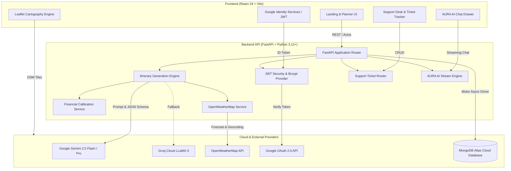

<div align="center">

# ✦ Aviaura
### *AI-Powered Luxury Travel Architecture & Smart Concierge Platform*

[](https://fastapi.tiangolo.com)
[](https://react.dev)
[](https://vitejs.dev)
[](https://www.mongodb.com/atlas)
[](https://ai.google.dev)
[](https://groq.com)
[](https://tailwindcss.com)

<p align="center">
  <b>Aviaura</b> is an intelligent, full-stack travel planning ecosystem that generates tailored, high-fidelity day-by-day travel itineraries with strict financial budget calibration, verified boutique stays, authentic culinary curation, live meteorological sync, interactive Leaflet route cartography, and a 24/7 dedicated AI concierge.
</p>

[Explore Features](#-core-capabilities) • [System Architecture](#-system-architecture) • [Getting Started](#-quickstart-guide) • [API Specification](#-rest-api-reference) • [Data Models](#-database-architecture)

---

</div>

## 🌟 Overview

Traditional travel aggregators overwhelm travelers with fragmented booking links, speculative estimates, and unrealistic schedules. **Aviaura** replaces guesswork with an intelligent end-to-end planning engine:

- **Strict Financial Calibration**: Budgets are enforced across accommodations, dining, local transit, and activities—with zero surprise fees or unrealistic spending assumptions.
- **Dynamic Meteorological Sync**: Automated 5-day OpenWeather integration with intelligent indoor contingency planning when rain or severe weather is detected.
- **Dietary & Cultural Precision**: Rigorous support for specialized dietary regimens (`100% Pure Veg`, `Jain-Friendly`, `Halal`, and coastal specialties).
- **AURA AI 24/7 Concierge**: Built-in conversational AI assistant capable of instant itinerary adjustments, alternative venue recommendations, and budget recalibration.
- **Support Ticket Desk**: Complete customer assistance pipeline backed by MongoDB Atlas, offering real-time ticket creation, indexing, and resolution tracking.
- **Single-Click Google OAuth**: Seamless, secure authentication using Google Identity Services and stateless JWT access sessions.

---

## ⚡ Core Capabilities

### 1. Precision Itinerary Generation
- Generates structured day-by-day schedules with realistic morning, afternoon, evening, and night pacing.
- Enforces travel-time buffers and geographic proximity between consecutive stops.
- Dual-pass AI orchestration: utilizes **Google Gemini 2.5 Flash** with automatic fallback to **Groq LLaMA-3** for instantaneous, fail-safe JSON generation.

### 2. Verified Stays & Culinary Curation
- Handpicked boutique stays, heritage havelis, and luxury ryokans calibrated to exact party sizes and room allotments.
- Verified dining spots with average price-per-person figures, signature dishes, and strict dietary verification.

### 3. Interactive Leaflet & OpenStreetMap Cartography
- Dynamic day-by-day interactive map plotting coordinates for every stop, accommodation, and dining venue.
- Smooth polyline flight paths and route overlays with custom dark-mode styled markers.

### 4. Interactive Financial Calibrator
- Real-time client-side budget estimator with dynamic per-person breakdown.
- Synchronized mathematical sliders with accurate milestone ticks and quick-select presets for party sizes (Solo, Couple, Family, Group) and trip durations.

### 5. Help Desk & Ticket Lifecycle Management
- Integrated support desk at `/support` allowing users to file priority assistance tickets (`< 2h` turnaround for urgent travel queries).
- Instant status lookup by Ticket ID (`AV-XXXX`) with real-time updates directly from MongoDB Atlas.

---

## 🏗️ System Architecture



---

## 💻 Tech Stack

| Layer | Technologies |
|---|---|
| **Frontend** | React 19, Vite, Vanilla CSS + TailwindCSS v4, Framer Motion, Lucide Icons, Axios |
| **Maps & Geospatial** | Leaflet.js, React-Leaflet, OpenStreetMap Tile Service |
| **Backend Framework** | FastAPI (ASGI), Uvicorn, Python 3.12+, Pydantic v2, Pydantic-Settings |
| **Database** | MongoDB Atlas (Cloud), Motor (Async Coroutine Driver), PyMongo |
| **AI / Large Language Models** | Google Gemini 2.5 Flash / Pro (`google-genai`), Groq Cloud LLaMA-3 (`groq`) |
| **Authentication** | Google OAuth 2.0 (Google Identity Services), PyJWT, Passlib / Bcrypt |
| **Meteorological Data** | OpenWeatherMap 5-Day 3-Hour Forecast API & Geocoding |

---

## 📁 Repository Structure

```
.
├── backend/
│   ├── app/
│   │   ├── main.py              # FastAPI application entrypoint & middleware
│   │   ├── config.py            # Pydantic Settings & environment variable validation
│   │   ├── db.py                # Async Motor MongoDB connection pool & index creation
│   │   ├── schemas.py           # Comprehensive Pydantic request/response data contracts
│   │   ├── deps.py              # JWT authentication dependencies & user resolver
│   │   ├── routers/
│   │   │   ├── auth.py          # Google OAuth, signup, and login endpoints
│   │   │   ├── trips.py         # Itinerary generation, save, retrieve, and delete
│   │   │   ├── chat.py          # AURA AI concierge conversation streaming
│   │   │   └── support.py       # Support ticket creation & real-time tracking
│   │   ├── services/
│   │   │   ├── gemini.py        # Gemini & Groq multi-LLM generation with strict JSON schema
│   │   │   ├── budget.py        # Algorithmic financial rollup & overspend detection
│   │   │   └── weather.py       # OpenWeatherMap geocoding & precipitation analysis
│   │   └── utils/
│   │       └── security.py      # Password hashing & JWT token encoding/decoding
│   ├── requirements.txt         # Production Python package dependencies
│   └── .env                     # Local backend environment variables (gitignored)
│
├── frontend/
│   ├── public/
│   │   ├── hero_bg.jpg          # High-resolution destination photography
│   │   ├── favicon.svg          # Aviaura brand vector favicon
│   │   └── destination_cards.jpg # Destination showcase assets
│   ├── src/
│   │   ├── api/                 # Axios HTTP client with Bearer auth interceptors
│   │   ├── components/          # Reusable UI components (Navbar, TripMap, AiChatbot, etc.)
│   │   ├── context/             # Global AuthContext provider & user session state
│   │   ├── pages/               # Landing, PlanTrip, Itinerary, Explore, About, Support, Login, Signup
│   │   ├── App.jsx              # Application router & protected routes
│   │   ├── index.css            # Core design system tokens, typography & luxury animations
│   │   └── main.jsx             # React DOM entrypoint
│   ├── package.json             # Frontend dependencies & scripts
│   └── vite.config.js           # Vite development server & reverse proxy configuration
│
├── .env.example                 # Comprehensive environment variable template
├── .gitignore                   # Multi-tier secret and build artifact exclusion
└── README.md                    # Platform documentation
```

---

## 🚀 Quickstart Guide

### Prerequisites
- **Python**: `3.11` or higher
- **Node.js**: `20 LTS` or higher
- **MongoDB Atlas**: Free Tier M0 Cluster or local MongoDB instance

---

### Step 1: Clone the Repository

```bash
git clone https://github.com/HoneyRathore1201/AviAura.git
cd AviAura
```

---

### Step 2: Configure Environment Variables

Create `.env` files for both backend and frontend based on [.env.example](.env.example):

#### 1. Backend (`backend/.env`):
```env
APP_NAME=Aviaura
APP_ENV=development
BACKEND_HOST=0.0.0.0
BACKEND_PORT=8000
FRONTEND_ORIGIN=http://localhost:5173

MONGODB_URI=your_mongodb_atlas_connection_string
MONGODB_DB_NAME=aviaura

JWT_SECRET=your_super_secret_random_hex_string
JWT_ALGORITHM=HS256
JWT_EXPIRE_MINUTES=10080

GOOGLE_CLIENT_ID=your_google_client_id.apps.googleusercontent.com
GOOGLE_CLIENT_SECRET=your_google_client_secret

GEMINI_API_KEY=your_gemini_api_key
GEMINI_MODEL_FLASH=gemini-2.5-flash
GEMINI_MODEL_PRO=gemini-3.1-pro-preview

GROQ_API_KEY=your_groq_api_key
GROQ_MODEL=llama3-8b-8192

OPENWEATHERMAP_API_KEY=your_openweathermap_api_key
OPENWEATHERMAP_UNITS=metric
```

#### 2. Frontend (`frontend/.env`):
```env
VITE_API_BASE_URL=
VITE_GOOGLE_CLIENT_ID=your_google_client_id.apps.googleusercontent.com
```

---

### Step 3: Run the Backend Service

```powershell
cd backend

# Create and activate virtual environment
python -m venv .venv
.\.venv\Scripts\Activate.ps1   # On Windows
# source .venv/bin/activate    # On macOS/Linux

# Install dependencies
pip install -r requirements.txt

# Start FastAPI development server
python -m uvicorn app.main:app --reload --port 8000
```

- API Server: `http://localhost:8000`
- Interactive OpenAPI Docs: `http://localhost:8000/docs`
- Health Check: `http://localhost:8000/api/health`

---

### Step 4: Run the Frontend Client

```powershell
cd frontend

# Install dependencies
npm install

# Start Vite client server
npm run dev
```

- Web Client: `http://localhost:5173`

---

## 📡 REST API Reference

### Authentication (`/api/auth`)
| Method | Endpoint | Description | Auth Required |
|---|---|---|---|
| `POST` | `/api/auth/google` | Verify Google OAuth credential, issue JWT token & profile | No |
| `POST` | `/api/auth/signup` | Register new account with name, email & password | No |
| `POST` | `/api/auth/login` | Authenticate with credentials and return JWT session token | No |

### Trip Planning & Itineraries (`/api`)
| Method | Endpoint | Description | Auth Required |
|---|---|---|---|
| `POST` | `/api/itinerary/generate` | Generate complete structured itinerary with AI & weather | No |
| `POST` | `/api/trips` | Save generated itinerary to user profile | Yes (JWT) |
| `GET` | `/api/trips` | Retrieve all saved trip plans for authenticated user | Yes (JWT) |
| `GET` | `/api/trips/{trip_id}` | Retrieve single saved trip by unique ID | Yes (JWT) |
| `DELETE` | `/api/trips/{trip_id}` | Delete trip plan and associated daily itineraries | Yes (JWT) |

### Support & Help Desk (`/api/support`)
| Method | Endpoint | Description | Auth Required |
|---|---|---|---|
| `POST` | `/api/support/tickets` | Create and store support ticket in MongoDB with unique ID (`AV-XXXX`) | No |
| `GET` | `/api/support/tickets/{ticket_id}` | Retrieve real-time resolution status of a support ticket | No |

### Concierge Assistant (`/api/chat`)
| Method | Endpoint | Description | Auth Required |
|---|---|---|---|
| `POST` | `/api/chat` | Conversational AURA AI assistant query with itinerary context | No |

---

## 🗄️ Database Architecture

Aviaura utilizes **MongoDB Atlas** with non-blocking async motor pools. The primary collections are:

### 1. `users`
```json
{
  "_id": "ObjectId",
  "name": "Julian Hayes",
  "email": "julian@aviaura.com",
  "google_id": "104928472910481234",
  "avatar": "https://lh3.googleusercontent.com/...",
  "created_at": "2026-10-20T00:00:00Z",
  "last_login": "2026-10-20T00:00:00Z"
}
```

### 2. `trip_plans`
```json
{
  "_id": "ObjectId",
  "user_id": "string",
  "destination": "Kyoto, Japan",
  "start_date": "2026-11-15",
  "duration_days": 5,
  "group_size": 2,
  "total_budget": 135000,
  "preferences": {
    "dietary": "veg_only",
    "activity_type": "cultural",
    "pace": "balanced"
  },
  "budget": {
    "total_estimated": 128400,
    "by_category": { "stay": 64000, "food": 32000, "transit": 16000, "activities": 16400 },
    "over_budget": false
  },
  "weather": [ ... ],
  "created_at": "2026-10-20T00:00:00Z"
}
```

### 3. `support_tickets`
```json
{
  "_id": "ObjectId",
  "ticket_id": "AV-0612",
  "name": "Aarav Sharma",
  "email": "aarav@domain.com",
  "category": "itinerary_help",
  "priority": "high",
  "subject": "Need hotel alternative in Kyoto for Day 3",
  "message": "Looking for a verified boutique ryokan with private onsen in Gion.",
  "status": "in_review",
  "estimated_response": "Under 2 hours",
  "created_at": "2026-10-20T01:02:44Z"
}
```

---

## 🛡️ Security & Privacy

- **Stateless Authentication**: JWT tokens signed with SHA-256 HMAC and configurable expiration windows.
- **Cryptographic Password Hashing**: Passwords are salted and hashed using `bcrypt` before storage.
- **Environment Isolation**: All database credentials, OAuth secrets, and API keys are managed exclusively via `.env` files excluded from version control.
- **CORS Protection**: Explicitly bound to configured frontend origins (`http://localhost:5173` in development).

---

## 📄 License

This project is licensed under the [MIT License](LICENSE).

---

<div align="center">
  <sub>Engineered with precision for modern travelers by <b>Honey Rathore</b> & the Aviaura team.</sub>
</div>
