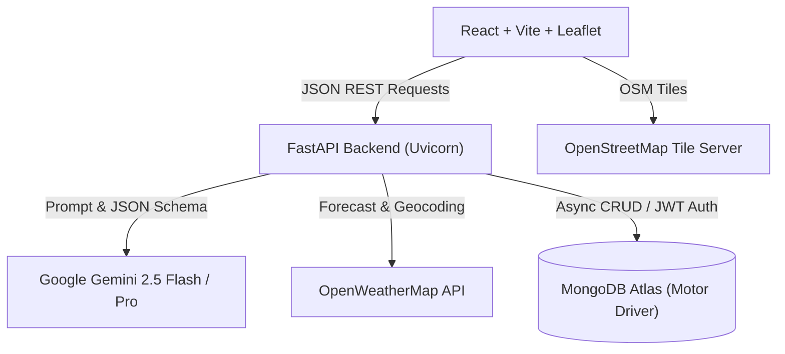

# Aviaura

AI-powered Smart Travel Assistant (MCA minor project).  
React (Vite) + FastAPI + MongoDB Atlas + Google Gemini + OpenWeatherMap + Leaflet/OSM.

You describe a destination, dates, group size, and budget. Aviaura generates a structured day-by-day itinerary, checks it against the budget, attaches a 5-day forecast, and plots stops on a map. Sign up to save trips.

## Demo defaults (for the viva)

- Currency: **INR**, budget is **total for the whole group** (stay + food + local transport + tickets).
- Form includes a **start date** (needed for weather). Duration is **1–10 days**.
- Weather uses OpenWeather’s free **5-day** forecast; later days show “beyond forecast window”.
- Maps: OpenStreetMap tiles, markers, straight polylines (no extra routing key).
- You can **generate without logging in**; login is only required to **save**.

## Prerequisites

- **Python 3.11** (3.10–3.12 is fine)
- **Node.js 20 LTS** (18+ is fine)
- Keys in `backend/.env` (copy from `.env.example`):
  - `GEMINI_API_KEY` — [Google AI Studio](https://aistudio.google.com/apikey) free tier
  - `OPENWEATHERMAP_API_KEY` — [OpenWeather](https://home.openweathermap.org/users/sign_up) free plan
  - `MONGODB_URI` — Atlas M0 SRV string
  - `JWT_SECRET` — `openssl rand -hex 32`

Atlas: create a database user, allow your IP (or `0.0.0.0/0` for a campus demo). Collections are created automatically.

## Run locally

**Backend** (from `backend/`):

```bash
python3 -m venv .venv
source .venv/bin/activate
pip install -r requirements.txt
python -m uvicorn app.main:app --reload --port 8000
```

Health check: http://127.0.0.1:8000/api/health  
Docs: http://127.0.0.1:8000/docs

**Frontend** (from `frontend/`):

```bash
npm install
npm run dev
```

Open http://localhost:5173 — Vite proxies `/api` to port 8000.

## Project layout

```
backend/app/
  main.py              FastAPI app, CORS, lifespan, health
  config.py            Pydantic Settings from .env
  db.py                Motor (async Mongo) connection pool
  schemas.py           Pydantic models & validation
  deps.py              JWT current user dependency
  routers/auth.py      Signup & login endpoints
  routers/trips.py     Generate, save, list, single view, delete
  services/gemini.py   Google GenAI SDK (strict JSON system prompt)
  services/budget.py   Totals, categorised rollups, overspend flag
  services/weather.py  OpenWeatherMap geocoding + 5-day forecast
frontend/src/
  pages/               Landing, PlanTrip, Itinerary, Login, Signup, Dashboard
  components/          Logo, GlassCard, TripMap (Leaflet), Skeleton, Navbar
  context/             AuthContext (JWT + user state)
  api/                 Axios client with bearer auth interceptor
```

## System Architecture



## API Sketch

| Method | Path | Auth | Purpose |
|---|---|---|---|
| POST | `/api/auth/signup` | No | Create user, hash password with bcrypt, return JWT |
| POST | `/api/auth/login` | No | Verify credentials, return JWT access token |
| GET | `/api/me` | Yes | Retrieve current authenticated user profile |
| POST | `/api/itinerary/generate` | No | Gemini prompt + weather forecast + stop geocoding |
| POST | `/api/trips` | Yes | Persist trip plan and daily itinerary items |
| GET | `/api/trips` | Yes | Retrieve saved trips for dashboard |
| GET | `/api/trips/{id}` | Yes | Re-open and view a saved itinerary |
| DELETE | `/api/trips/{id}` | Yes | Delete a saved trip plan and daily records |

## MongoDB Collections (Data Models)

1. **`users`**:
   - `_id`: ObjectId
   - `name`: string
   - `email`: string (unique)
   - `password_hash`: string (bcrypt hashed)
   - `created_at`: ISODate
2. **`trip_plans`**:
   - `_id`: ObjectId
   - `user_id`: string (reference to user)
   - `destination`: string
   - `start_date`: string (YYYY-MM-DD)
   - `duration_days`: integer (1-10)
   - `total_budget`: float
   - `group_size`: integer
   - `preferences`: `{ dietary, activity_type, pace }`
   - `budget`: `{ total_estimated, by_category, over_budget, note }`
   - `weather`: array of daily forecasts
   - `created_date`: ISODate
3. **`daily_itineraries`**:
   - `trip_id`: string
   - `day_number`: integer
   - `time_slot`: string (e.g. "09:00-12:00")
   - `activity_name`: string
   - `location_name`: string
   - `location_coords`: `{ lat, lon }`
   - `category`: string ("food", "activity", "transport", "lodging")
   - `estimated_cost`: float

## MCA Viva / Presentation Cheat Sheet

- **Why FastAPI over Django/Flask?**
  FastAPI has native async/await support, essential for making concurrent I/O calls to Gemini and OpenWeatherMap without blocking server threads. It also provides automatic Swagger docs (`/docs`) and Pydantic data validation.
- **Why Motor instead of PyMongo?**
  Motor provides a non-blocking, async coroutine driver for MongoDB, seamlessly integrating with FastAPI's event loop.
- **How is structured output guaranteed from Gemini?**
  Using Gemini's `response_mime_type="application/json"` with an explicit system prompt and defensive JSON parsing (`json.loads`, regex extraction, and schema filling). If costs exceed budget, an automatic second-pass hard-cap re-prompt is executed.
- **How does weather integration affect the itinerary?**
  OpenWeatherMap forecasts detect precipitation (`rain_mm >= 2` or rain descriptions). Rainy days automatically annotate activities with indoor alternatives.
- **How are maps rendered without billing keys?**
  Leaflet.js loads open-source OpenStreetMap raster tiles, rendering dynamic polylines and custom CSS-styled markers using coordinates generated by the backend.
